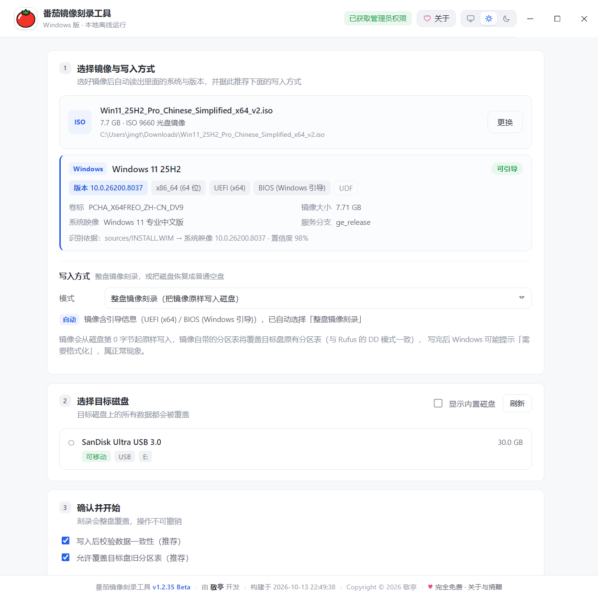

# 番茄镜像刻录工具

**Windows** 平台的 U 盘 / SD 卡镜像刻录工具，基于 Electron + React + TypeScript。

> macOS 版暂时不开发（2026-10-13 决定，手边没有 mac 环境）。界面与文档一律按
> Windows 单平台写；源码里的 macOS 适配层先留着，将来恢复时不必重写。

**当前版本**：v1.2.54（Beta）· **开发者**：敬亭 · **许可证**：[MIT](LICENSE)

## 界面预览



> 主界面：自动识别镜像里的系统版本与构建号，推荐写入方式，选择目标 U 盘后一键开始刻录。

## 开源

代码开源，任何人都可以查看、编译、修改 —— 一个要往你 U 盘里写数据的软件，理应经得起所有人审视：没有暗桩，不上传任何数据。

- **仓库地址**：[github.com/jingting-ai/tomato-iso-burner](https://github.com/jingting-ai/tomato-iso-burner)（应用内「关于」面板也会同步显示入口）
- 基于 [MIT 许可证](LICENSE) 发布，欢迎 Star、提 Issue、贡献代码

## 功能

- **镜像写入**：ISO / IMG / DMG / VHD 等原始镜像，1 MiB 分块流式写入，实时进度、速度、剩余时间
- **SHA256 校验**：写入后自动读回目标设备逐字节比对，确保数据一致
- **安全防护**：
  - 系统盘 / 启动盘自动识别并禁止写入（`IsSystem` / `IsBoot` / 系统盘符）
  - 默认只显示可移动磁盘，内置磁盘需手动开启"显示内置磁盘"；选中内置硬盘会弹强提醒，二次确认后才放行
  - 开始刻录前需要勾选"已备份重要数据"二次确认
  - 写入容量预检（镜像大于目标设备时拒绝）
- **自动权限提升**：打包版启动时通过 UAC（`Start-Process -Verb RunAs`）自动提权
- **设备管理**：diskpart 自动卸载占用、清理分区表、写后重新扫描；完成后可一键安全弹出
- **可取消**：任意阶段可中止，中止后自动恢复磁盘联机状态

## 平台实现原理（Windows）

| 环节 | 实现 |
|------|------|
| 设备枚举 | PowerShell `Get-Disk` + `Get-Partition`/`Get-Volume`（Base64-UTF8 输出规避编码问题） |
| 写入路径 | `\\.\PhysicalDriveN`（512 字节扇区对齐，末块自动补零） |
| 释放占用 | `diskpart`：`clean`（可清空分区表）→ 失败则 `offline disk` |
| 写后恢复 | `online disk` + `rescan` |
| 安全弹出 | `diskpart offline disk` |

## 开发

```bash
npm install        # 已配置 npmmirror 镜像（.npmrc）
npm run dev        # 开发模式
npm run typecheck  # 类型检查
npm run build      # 构建产物（out/）
```

> 开发模式下刻录需要权限：请以管理员身份运行终端再 `npm run dev`。
> 沙箱 / 无 GPU 环境（VM、CI）下应用默认禁用硬件加速，属正常行为。

## 版本管理

版本号采用语义化版本 `major.minor.patch`，**随功能改进自动递增**，无需手动维护：

- `npm run build` / `npm run dist:*` 前会自动执行 `tools/version.cjs auto`：
  - 对 `src/` 全部源码计算快照哈希，与 `version-state.json` 中记录的上次构建对比；
  - **源码有变化 → patch 自动 +1**；无变化则保持版本号（重复构建不会虚增）；
- 需要发布较大功能时手动升档：
  ```bash
  npm run version:patch   # 小修 / 改进（一般不需要，build 会自动做）
  npm run version:minor   # 新功能
  npm run version:major   # 大版本
  # 可带说明：npm run version:minor -- --note "新增压缩镜像支持"
  ```
- 自动同步的内容：
  - `package.json` 的 `version`
  - `src/shared/version.ts`（界面显示用常量，自动生成勿手改）
  - `CHANGELOG.md`（更新日志，新条目插入顶部）
  - `version-state.json`（快照与历史，请勿手改）
- 界面上的版本展示：窗口标题 `番茄镜像刻录工具 vX.Y.Z`、「关于」面板版本徽章（预发布版本带 `Beta` 渠道标识，由 `tools/version.cjs` 的 `APP_CHANNEL` 控制）、底部状态栏「由 敬亭 开发 · 构建于 …」；打包产物目录名带版本号（如 `TomatoIsoBurner-win32-x64-v1.0.1`），并附 `VERSION.txt`。

## 打包

### ① 安装版（推荐）

```bash
npm run dist:win
# → dist/番茄镜像刻录工具-<版本>-win-x64.exe        NSIS 安装程序（约 80 MB）
# → dist/番茄镜像刻录工具-<版本>-portable.exe        单文件便携版（约 80 MB）
```

安装版提供标准安装向导（简体中文）：可选安装目录、自动创建桌面与开始菜单快捷方式、在「应用和功能」中生成卸载项，并以管理员权限启动（刻录需要）。

### ② 单文件便携版（= 用户说的「绿色版」）

上一条命令同时产出 `…-portable.exe`：双击直接运行、无需安装。
分发时把它拷成固定名字，例如 `E:\番茄镜像刻录工具-绿色版.exe`，桌面快捷方式指向它。

**它和安装版的行为差异，全部由 `src/main/index.ts` 顶部的形态判定决定：**

| | 安装版 | 绿色版（单文件 / 目录） |
|---|---|---|
| 判定 | `process.execPath` 落在 `Program Files` 下 | portable 目标会把 `PORTABLE_EXECUTABLE_FILE` 传进来；兜底再判 `execPath` 是否在 `%TEMP%` 下。**目录版**则用「不在 Program Files 里」判定（`isGreenFolder`） |
| 配置/缓存 | `%APPDATA%\番茄镜像刻录工具\` | 系统临时目录 `%TEMP%\tomato-iso-burner-portable`（目录版是 `…-green`），**不碰 %APPDATA%** |
| 启动日志 | 实时追加 `startup.log` | `diagInit('deferred')` —— **平时一个文件都不产生**，只有出现 `!!` 开头的异常记录时才整段落盘（也在临时目录里） |
| 管理员权限 | exe 清单是 `requireAdministrator`，双击即带权限 | 单文件版的外层启动器是 `asInvoker`，所以程序**自己补一次 `elevate()`**（`TOMATO_ELEVATED` 环境变量做防重入标记，拒绝 UAC 也不会无限重启） |

⚠️ **三种形态的 userData 必须分开**：共用同一份会让 Electron 的单实例锁互相顶掉 ——
先开安装版、再双击绿色版，后者会「静默退出、界面什么都不显示」，用户报的就是「双击没反应」。
另外单实例锁没拿到时**绝不静默退出**，会弹一个说明框（`app.whenReady()` 里，见
`!hasSingleInstanceLock` 分支）。

### ③ 绿色目录版（不压缩，约 270 MB / 目录）

```bash
npm run dist:portable
# → dist/TomatoIsoBurner-win32-x64-v<版本>/番茄镜像刻录工具.exe
```

脚本把构建产物打成 `app.asar` 并套上 Electron 的 Windows 运行时，整个目录可直接拷贝使用。仅在无法运行 electron-builder 的受限环境（如无符号链接权限的沙箱）时使用。

### 打包注意事项

- **Electron 版本必须固定**：electron-builder 无法处理 `^33.3.1` 这类范围，已在 `package.json` 与 `electron-builder.yml` 中固定为 `33.4.11`。
- **国内加速**（可选，下载 Electron / NSIS 等二进制时）：

  ```bash
  export ELECTRON_MIRROR="https://registry.npmmirror.com/-/binary/electron/"
  export ELECTRON_BUILDER_BINARIES_MIRROR="https://registry.npmmirror.com/-/binary/electron-builder-binaries/"
  ```
- 图标由脚本生成，别手改 `build/` 里的产物（**界面 logo 与系统图标是两条独立的线，不要"统一"**）：
  - `python tools/make-icon.py` —— **系统图标** `build/icon.ico`（16~256 七个尺寸）+ `build/icon.png`（1024），浅蓝圆角方块，供 exe / 安装包 / 快捷方式 / 任务栏 / 窗口图标使用；源图 `assets/app-icon-source.png`（当前 = **Q 版「番茄抱着 U 盘」**，番茄画法取自用户给的扁平卡通番茄原型）
    ⚠️ 换 AI 出的源图时，**先跑** `python tools/_qicon_bg.py <原图> assets/app-icon-source.png "#B7D0EE"` —— 它把方块底色换成指定的浅蓝、并把「浅底 → 白圆角外」的抗锯齿残留一起重做。不做这一步的话：① 底色渐变不统一；② 圆角弧线上的残留浅色像素会被 make-icon 的边缘亮边检查判成「边缘有白边」（实测漏 40 像素）
    ⚠️ 源图无 AI 水印时跑构建加 `TOMATO_ICON_NO_CLEAN=1`（清洗判据是为 AI 水印写的，会误伤浅灰插头）
  - `python tools/make-logo-tomato.py` —— **界面 logo** `src/renderer/src/assets/app-logo.png`（256×256，白底），顶栏与「关于」面板共用；源图 `assets/_logo-src/f-white.png`（当前 = **Q 版方案 F「番茄 + 箭头 + U 盘」的白底重绘版**）。⚠️ 界面 logo 与系统图标是两条独立的线，别去"统一"
  - 两者互不共用代码：改系统图标不影响界面 logo，反之亦然
  - ⚠️ 白底源图必须走 `WHITE_T = 245`：AI 出的白底带一层 245~250 的极浅噪点，
    阈值放到 250 会让包围盒撑满整张画布，番茄被缩成一小坨
  - ⚠️ **换了图标但任务栏还是旧图 ≠ 打包没生效**：先拿证据（`python tools/verify-icon.py <exe>`，
    或直接从 exe 里按偏移把 PNG 抠出来看），确认 exe 内嵌图标是新的之后，
    剩下就是 Windows 的图标缓存没跟着刷 —— 让用户跑 `刷新任务栏图标.cmd`
    （关 explorer → 删 iconcache → 起 explorer）。
    主进程里另外补了 `app.setAppUserModelId('com.doro.isoburner')`（值必须和
    electron-builder.yml 的 appId 一致），让任务栏项和安装包写进快捷方式的身份对得上号

## 使用说明

1. **选择镜像** → 点击卡片选择 ISO/IMG 文件（也可以拖入窗口）
   - 选好后会自动读出镜像里的系统与版本，结果显示在**同一张卡的下半部分**：上半是选中的文件，
     下半是识别结果。两半共用同一个边框、同一种外观（**没有第二条彩色竖边**，
     2026-10-14 用户要求「合并到同一个框里、外观按第一个框的格式」）；
     家族色改染在「Windows / Linux」那枚小徽标上（`.image-card.fam-*` → `--fam` → `.probe-family`）
   - 读取过程是一段光盘读取动画（旋转光盘 + 扩散脉冲 + 不定量进度条 + 步骤轮播）。
     进度条刻意**不报百分比**：这一步在主进程里是一次性完成的，中间拿不到真实进度
2. **写入方式** → 模式下拉框右边有个 `?`（`components/Hint.tsx`）：
   长说明**默认收纳**，鼠标悬停 / 键盘聚焦才弹出来，文案跟着当前模式变
3. **选择目标磁盘** → 插入 U 盘后点"刷新"，选择目标（系统盘会被锁定不可选）
4. **确认并开始** → 勾选"已备份数据" → 点击"开始刻录"
5. 等待写入 + 校验完成 → 点击"安全弹出"后拔出 U 盘
   - 写入 / 校验过程中，运行日志**每跨过 10% 记一条**（`已写入 30%（1.9 GB / 6.4 GB）·
     42 MB/s · 剩余约 2 分 10 秒`），外加 60 秒心跳。
     ⚠️ 2026-10-14 之前整段写入在日志里是**完全空白**的（只有开头/结尾各一条），
     用户报的就是「日志里面怎么没有写入镜像什么的日志啊」——别再退回去

**「关于 / 捐赠」是独立窗口**（2026-10-14）：顶栏「关于」/ 底栏「关于」/ 底栏「捐赠」
三个入口都通过 `api.openAbout(section)` 让主进程另开一个 `BrowserWindow`
（`createAboutWindow`），渲染层靠 URL hash（`#about` / `#donate`）切换身份。
点「捐赠」直接停在收款码那一节。它**不是**主界面里的弹层 —— 弹层那套遮罩会把主界面
顶栏一起压暗、还要给右上角窗口按钮换色，用户原话是「一点关于，上面就很不协调」。
主界面里现在只剩「内置硬盘强提醒」一个弹层。

## 项目结构

```
src/
├── main/                 # Electron 主进程
│   ├── index.ts          # 窗口与 IPC 编排 + 形态判定（安装版 / 绿色单文件 / 绿色目录）
│   ├── diag.ts           # 启动自述日志（安装版实时落盘；绿色版 deferred，异常才落盘）
│   ├── writer.ts         # 刻录引擎（分块写入 / SHA256 校验 / 取消）
│   ├── elevate.ts        # 平台权限提升
│   ├── exec.ts           # 子进程封装（PowerShell Base64 输出）
│   ├── plist.ts          # Apple XML plist 解析器（macOS 适配层的一部分，暂未启用）
│   └── platform/         # 平台适配层
│       ├── windows.ts    # Get-Disk 枚举 + diskpart 管理  ← 当前唯一在用的实现
│       └── darwin.ts     # diskutil 枚举与管理（macOS 暂缓开发，先留着）
├── preload/index.ts      # contextBridge API
├── shared/               # 主/渲染进程共享类型与 IPC 契约（含自动生成的 version.ts、外链常量 links.ts）
└── renderer/             # React 界面
tools/
├── version.cjs           # 版本号自动递增 + 生成版本常量/更新日志
├── package-win.cjs       # Windows 便携版打包
├── ui-gallery.cjs        # 界面效果图（离屏截 主界面/设备列表/刻录中…）
│   └── 加 `TOMATO_SHOT_PROBE_DELAY=4000` 可把「识别中」那一段动画也截下来
│       （识别会故意慢下来；不配就截不到，因为识别早跑完了）
│   └── `TOMATO_SHOT_W/H` 改窗口尺寸、`TOMATO_OUT` 改产物目录（用来验证「窗口最窄 880 时
│       副标题会不会被省略号截掉」这类问题）；脚本会打印副标题的 可用/需要 宽度
│   └── `TOMATO_HASH=about|donate` 截「关于 / 捐赠」那个**独立窗口**
│       （它与主界面共用同一份渲染层，靠 hash 分身，所以要单独跑一次）
├── 刷新任务栏图标.cmd      # 换了图标但任务栏/桌面还是旧图时跑一次（清 Windows 图标缓存）
├── make-icon.py          # 系统图标（build/icon.ico，浅蓝圆角方块 + Q 版番茄抱 U 盘）
├── _qicon_bg.py          # 换 AI 图标源图时：重做方块底色与圆角边（必跑，否则边缘亮边检查会报警）
├── _cute_compare.py      # 图标候选「原版 vs 更可爱」对照图（含 16/32/48px 缩略）
├── _tomato_geo.py        # 早期手绘几何候选（已不用，留作备查）
└── make-logo-tomato.py   # 界面 logo（app-logo.png，白底番茄 + 箭头 + U 盘）
    └── 注：系统图标与界面 logo 是两条独立的线，前者蓝底、后者白底，别去"统一"
CHANGELOG.md              # 更新日志（自动维护，新版本插顶部）
LICENSE                   # MIT 许可证
version-state.json        # 源码快照哈希与版本历史（自动维护）
```

## 已知限制

- `.gz` / `.xz` 压缩镜像暂不支持自动解压，请先解压
- Windows 上 `diskpart clean` 不可用时（如有页面文件占用）会自动退回"磁盘脱机"方式
- 便携版 exe 未做代码签名，首次运行可能弹出 Windows SmartScreen 提示，选"仍要运行"即可
- 刻录需要管理员权限：安装版双击即带权限；**绿色版会自己补一次提权**（拒绝 UAC 则退化成
  普通权限打开，界面上有提示和「以管理员重启」按钮）
- 绿色版（单文件 / 目录）的配置和缓存都在系统临时目录，**关掉程序后不保证还在** ——
  界面主题这类偏好每次可能回到默认。安装版不受影响
